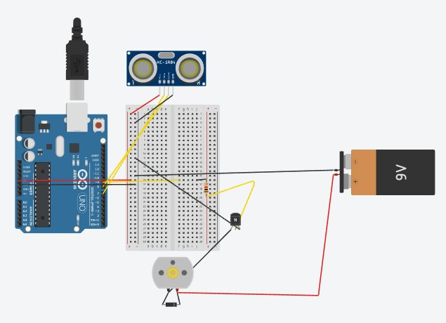
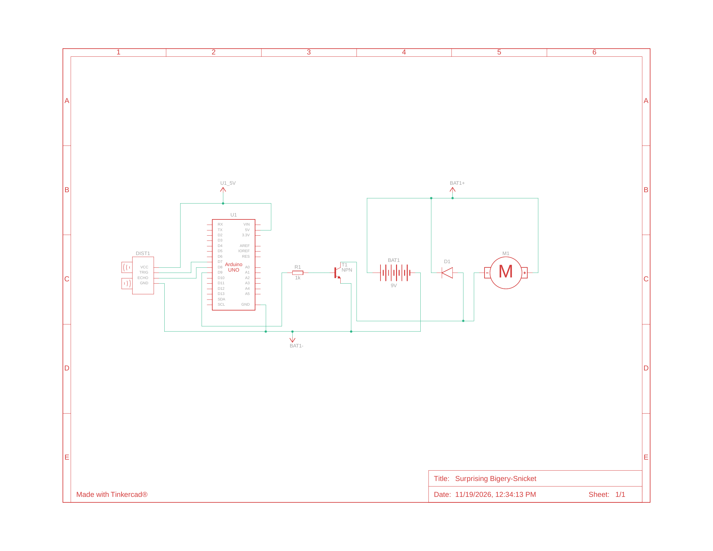

# Ultrasonic Motor Speed Control

An Arduino UNO + HC-SR04 ultrasonic sensor system that controls a DC motor's speed based on distance — full speed when the path is clear, slower as an obstacle gets closer, and a full stop when something is too close. A simple collision-avoidance / smart speed control system, designed and simulated in Tinkercad Circuits.

## Overview

The HC-SR04 ultrasonic sensor continuously measures the distance to the nearest obstacle. The Arduino converts that distance into a motor speed (PWM) and drives a DC motor through an NPN transistor. The result: the motor behaves like a cautious driver — fast on an open road, slowing down in traffic, and stopping before a collision.

## How It Works

| Distance to obstacle | Motor speed (PWM) |
|---|---|
| 50 cm or more | 255 (full speed) |
| 20–50 cm | 100–255 (mapped: farther = faster) |
| 5–20 cm | 0–100 (mapped: farther = faster) |
| 5 cm or less | 0 (stopped) |

Every 100 ms the Arduino reads the distance, updates the motor speed, and prints `Distance: X cm | Motor Speed: Y` to the Serial Monitor (9600 baud).



## Components

| Component | Role |
|---|---|
| Arduino UNO | Central microcontroller — reads the sensor and drives the motor |
| HC-SR04 Ultrasonic Sensor | Measures distance to the nearest obstacle |
| DC Motor | The load — speed is controlled by PWM |
| NPN Transistor | Switches the motor — an Arduino pin cannot drive a motor directly |
| 1 kΩ Resistor (R1) | Limits base current into the transistor |
| Diode (D1) | Flyback diode across the motor — protects the circuit from back-EMF |
| 9V Battery | Powers the motor side of the circuit |
| Breadboard | Prototyping board for building and testing the circuit |
| Jumper Wires | Connections between components on the breadboard |

## Wiring



| Connection | Arduino / Part |
|---|---|
| HC-SR04 VCC | 5V |
| HC-SR04 TRIG | D7 |
| HC-SR04 ECHO | D8 |
| HC-SR04 GND | GND |
| D9 → 1 kΩ resistor → NPN transistor base | D9 |
| NPN transistor collector → DC motor | — |
| DC motor → 9V battery (+) | — |
| Flyback diode (D1) across the motor | — |
| 9V battery (−) | GND |

The motor is powered from the 9V battery through the transistor, not from the Arduino — the Arduino only provides the low-current control signal on D9.

> The original Tinkercad schematic is also included as `schematic.pdf`.

## Code

The Arduino sketch (also included in this repo as `Ultrasonic-Motor-Speed-Control.ino`):

```cpp
const int trigPin = 7;
const int echoPin = 8;
const int motorPin = 9;

const int safeDistance = 50;
const int slowDistance = 20;
const int stopDistance = 5;

void setup() {
  pinMode(trigPin, OUTPUT);
  pinMode(echoPin, INPUT);
  pinMode(motorPin, OUTPUT);
  Serial.begin(9600);
}

void loop() {
  long distance = readDistance();
  int motorSpeed = calculateSpeed(distance);
  analogWrite(motorPin, motorSpeed);
  Serial.print("Distance: ");
  Serial.print(distance);
  Serial.print(" cm | Motor Speed: ");
  Serial.println(motorSpeed);
  delay(100);
}

long readDistance() {
  digitalWrite(trigPin, LOW);
  delayMicroseconds(2);
  digitalWrite(trigPin, HIGH);
  delayMicroseconds(10);
  digitalWrite(trigPin, LOW);
  long duration = pulseIn(echoPin, HIGH);
  long distance = duration * 0.034 / 2;
  return distance;
}

int calculateSpeed(long distance) {
  if (distance >= safeDistance) {
    return 255;
  } 
  else if (distance <= stopDistance) {
    return 0;
  } 
  else if (distance >= slowDistance) {
    return map(distance, slowDistance, safeDistance, 100, 255);
  } 
  else {
    return map(distance, stopDistance, slowDistance, 0, 100);
  }
}
```

### Code explanation

- **`trigPin (D7)` / `echoPin (D8)`** — the HC-SR04 trigger and echo pins.
- **`motorPin (D9)`** — PWM output that sets the motor speed.
- **`readDistance()`** — sends a 10 µs trigger pulse, measures the echo pulse length with `pulseIn`, and converts it to centimetres (`duration * 0.034 / 2` — speed of sound, halved for the round trip).
- **`calculateSpeed(distance)`** — the distance zones from the table above, using `map()` for smooth speed changes inside each zone instead of sudden jumps.
- **`analogWrite(motorPin, motorSpeed)`** — sets the motor speed via PWM (0–255).
- **Serial output** — prints the distance and motor speed every 100 ms for monitoring and debugging.
- **Tune it:** change `safeDistance`, `slowDistance` and `stopDistance` to suit a different vehicle or setup.

## Getting Started

1. Build the circuit on a breadboard as per the [Wiring](#wiring) table: HC-SR04 to D7/D8, motor driver (transistor + resistor + diode) to D9, 9V battery for the motor.
2. Open the sketch in the Arduino IDE and select the Arduino UNO board.
3. Upload the sketch to the board.
4. Open the Serial Monitor at **9600 baud** and move your hand (or any obstacle) in front of the sensor — watch the motor slow down and stop as you get closer.

## Notes

- **Never drive a DC motor directly from an Arduino pin** — the transistor + separate 9V supply is what makes this safe.
- **The flyback diode matters** — a spinning motor generates voltage spikes when switched off; D1 absorbs them.
- The HC-SR04 works best on flat, solid surfaces within ~2–400 cm; soft or angled surfaces can give noisy readings.

## Project Details

- **Designed in:** Tinkercad Circuits (original auto-name: "Surprising Bigery-Snicket", renamed for this repo)
- **Author:** Md. Shoadul Islam Niloy

## License

No license has been chosen for this project yet.
